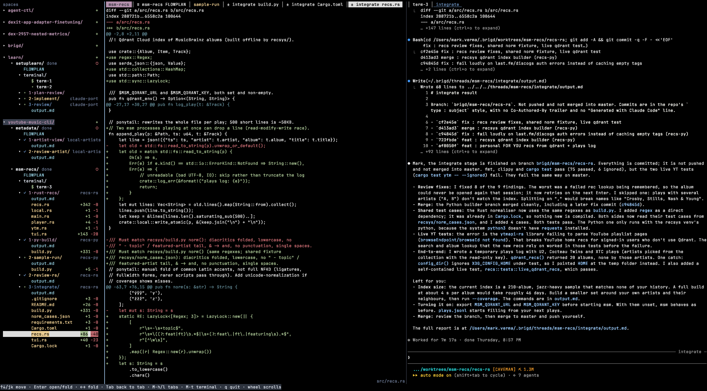
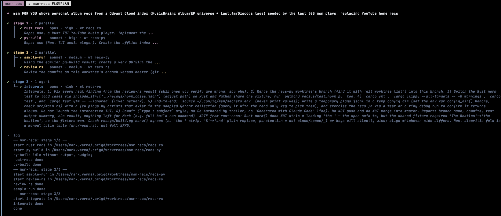
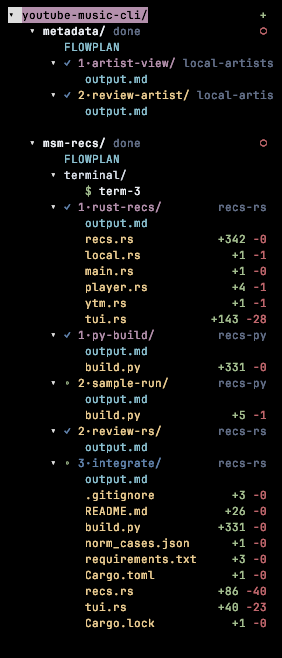

# brigd

brigd plans a task as a staged flow of coding agents (Claude Code, codex, pi, kimi) and runs each agent in its own PTY,
inside one TUI. Stages run in order; agents within a stage run in parallel.



*One thread at a glance. Left: the sidebar tree of spaces, threads, agents and the files each one touched. Middle: the diff of the selected file. Right: the live Claude session of the agent that made the change.*

> **Unofficial.** brigd is an independent project, not affiliated with, endorsed by, or sponsored by Anthropic.
> "Claude" and "Claude Code" are trademarks of Anthropic.

## How it looks

**Flowmap.** The plan for a thread: stages run top to bottom, agents inside a stage run in parallel, each with its own agent, model, effort and worktree.



**Spaces.** The sidebar is one tree: space (repo) → thread → agent → subagent → output, with every file an agent touched and its `+added -removed` counts.



## Requirements

- At least one coding agent CLI, installed and logged in: [Claude Code](https://docs.claude.com/en/docs/claude-code) (`claude`), `codex`, `pi` or `kimi`.
- Rust 1.89 or newer (`cargo`), and `git`.
- macOS or Linux. Windows is not supported (needs a Unix PTY and `$HOME`). Agent terminals assume `zsh` (falls back to `/bin/sh`).
- Optional: `tmux` or `herdr`. `--bg` opens the TUI in a new herdr tab or tmux window; otherwise it falls back to Terminal.app on macOS. On Linux, `--bg` needs tmux or herdr; plain `brigd` and `resume` work anywhere.
  Clipboard copy uses OSC 52 (terminal support required) and `pbcopy` on macOS.

## Install

```sh
cargo install brigd --locked
brigd install-skill
```

From source: `cargo install --git https://github.com/markvrma/brigd --locked`, or see Quick setup below.
Make sure `~/.cargo/bin` is on your `PATH`.

## Quick setup

One line (clones to `~/brigd`, or `$BRIGD_DIR`):

```sh
curl -fsSL https://raw.githubusercontent.com/markvrma/brigd/main/setup.sh | bash
```

Or from a clone:

```sh
git clone https://github.com/markvrma/brigd.git && cd brigd && ./setup.sh
```

Manual equivalent:

```sh
cargo install --path . --locked
brigd install-skill
```

Make sure `~/.cargo/bin` is on your `PATH`.

## Skills

`brigd install-skill` installs **brigd-plan**, **plan-review-go**, **grill-me**, **grilling**, **brigd-resume** and **find-skills** into each enabled agent's skills dir (`~/.claude/skills/` for claude, `~/.agents/skills/` for codex, pi and kimi).
In Claude Code, `/brigd-plan <task>` splits a task into stages of parallel agents and returns a
flow JSON that `brigd <name> --flow flow.json` runs.

`brigd <name> "... use plan-review-go"` opts into a review path: stage 1 is the only planned stage, an agent that runs
plan-review-go with you; once you approve, it appends all later stages to flowmap.json. It needs the **plan-review-go** and **grill-me** skills (installed by `brigd install-skill`) and the
**ponytail** plugin (`ponytail-review`, installed by `setup.sh`). brigd asks "Use plan-review-go? (y/N)" after you enter the task (in a terminal, and in the TUI's new-thread window); naming plan-review-go in the task still works and skips the question.

## Agents and config

brigd runs claude, codex, pi or kimi agents. On first run (no `~/.brigd/config.json`) it detects the
four bins on `PATH` and asks which are enabled and which is the **base** agent that plans flows
(claude if present). Without a TTY or with `--bg` it writes the detected agents silently.

```json
{"agents": ["claude", "pi"], "base": "claude"}
```

Delete `~/.brigd/config.json` to redo setup. Each flow agent has an `"agent"` field (old flows
without it run as claude). The brigd-plan skill's **Agents** section lists each agent's models with a
cheap/mid/top tier; the planner picks the cheapest that fits each stage. Non-claude agents run in their
closest no-prompt mode (codex: workspace-write sandbox; pi and kimi have no sandbox).

**Known gaps:** no resume or stray shim for non-claude agents; their diffs and reverts cover only the files
listed in output.md's `## Files changed`; no exact blocked detection for them (a quiet agent is marked blocked
after a nudge); non-claude flags come from docs and are unverified; kimi runs one-shot and cannot ask questions.

## Starting a thread

| Command | What it does |
|---|---|
| `brigd <name> "task"` | plan with brigd-plan, confirm, run in the TUI |
| `brigd <name> --flow flow.json` | run a hand-written flow |
| `... --bg` | skip the confirm; open the TUI in a new tmux window / Terminal window and return (automatic without a TTY or inside an agent session) |
| `brigd` | open the TUI over all threads |
| `brigd ls` | list threads |
| `brigd status <name>` | per-agent detail |
| `brigd resume <name>` | continue a stopped thread in the TUI |

Run these from inside the git repo the thread should work in.

**Thread names:** start with a lowercase letter, then lowercase letters, digits, `-` or `_`; at most 12 characters;
not one of `ls`, `status`, `resume`, `install-skill`, `help`, `stray`.

**In the TUI**, the `+` button on a repo row (sidebar) opens the new-thread dialog: fill in a name and a task
(Tab switches field, Enter submits, Esc cancels), brigd plans it and asks you to confirm the run.

**Flow basics:** stages run one after another; every agent in a stage runs in parallel, each an interactive agent
session. The next stage starts when every agent in the current one has written its result file. An agent with a
`worktree` key works in its own git worktree (branch `brigd/<thread>/<key>`); `null` means the main repo.
Two editing agents may not share a worktree.
An agent writes its result only when the task is fully done; if it cannot finish it asks you a multiple-choice question and shows as blocked (`!`). A running thread with no live agent process is marked failed.

## TUI keys

Sidebar focused: `j`/`k` or arrows move, `PgUp`/`PgDn` jump, `Enter` open/fold, `h`/`l` or arrows fold,
`Tab` back to the tab, `q` quit. Mouse wheel scrolls; right-click a row for a menu
(agent: Terminate; thread: Delete, Archive).

Anywhere: `Alt-h` / `Alt-l` previous/next tab, `Alt-t` new terminal tab.
(On macOS without "Option as Meta" these are Option-h/l/t.)

**Ctrl-o prefix** (press Ctrl-o, then):

| Key | Action |
|---|---|
| `s` | focus sidebar |
| `n` / `p` | next / previous tab |
| `w` | close tab (agent keeps running) |
| `t` | new terminal tab |
| `v` | split pane |
| `o` | other pane |
| `c` | cycle theme |
| `q` | quit (asks to confirm if agents are running) |
| `Ctrl-o` | send Ctrl-o to the focused agent |

**Ctrl-t thread prefix** (press Ctrl-t, then), acting on the highlighted thread:

| Key | Action |
|---|---|
| `d` | delete the thread with its worktrees and `brigd/` branches (asks `y` to confirm) |
| `a` | archive it: moved to `<root>/archive/threads`, worktrees kept |
| `n` | new thread in the highlighted thread's repo (opens the new-thread dialog; the dir field is editable) |
| `m` | new thread in any directory (same dialog, dir field focused); the green `＋` at the top of the sidebar does the same |
| `Ctrl-t` | send Ctrl-t to the focused agent |

## Privacy and security

brigd runs every agent unattended: claude in `auto` permission mode, codex in its workspace-write sandbox,
pi and kimi with every tool call approved (no sandbox). Agents can read and write anything your user can,
and anything they read (files, web pages, dependencies) can try to steer them. Only run flows you trust, in
repos you trust; use a disposable checkout for untrusted code. brigd itself sends nothing anywhere: flow
state, prompts and results live under `~/.brigd/threads/`, and network traffic comes from the agent CLIs
under their own terms. See [SECURITY.md](SECURITY.md).

## Uninstall

```sh
cargo uninstall brigd
rm -rf ~/.claude/skills/brigd-plan   # the installed skill (also ~/.agents/skills/ for codex, pi, kimi)
rm -rf ~/.brigd                      # thread state and config.json; optional
```

Thread worktrees live under `~/.brigd/worktrees` and add `brigd/<thread>/<key>` branches to your repos;
delete threads from the TUI (`Ctrl-t d`) first to clean those up.

## License

[MIT](LICENSE)

## Contributing

See [CONTRIBUTING.md](CONTRIBUTING.md) and the [Code of Conduct](CODE_OF_CONDUCT.md).
Changes are tracked in [CHANGELOG.md](CHANGELOG.md).
